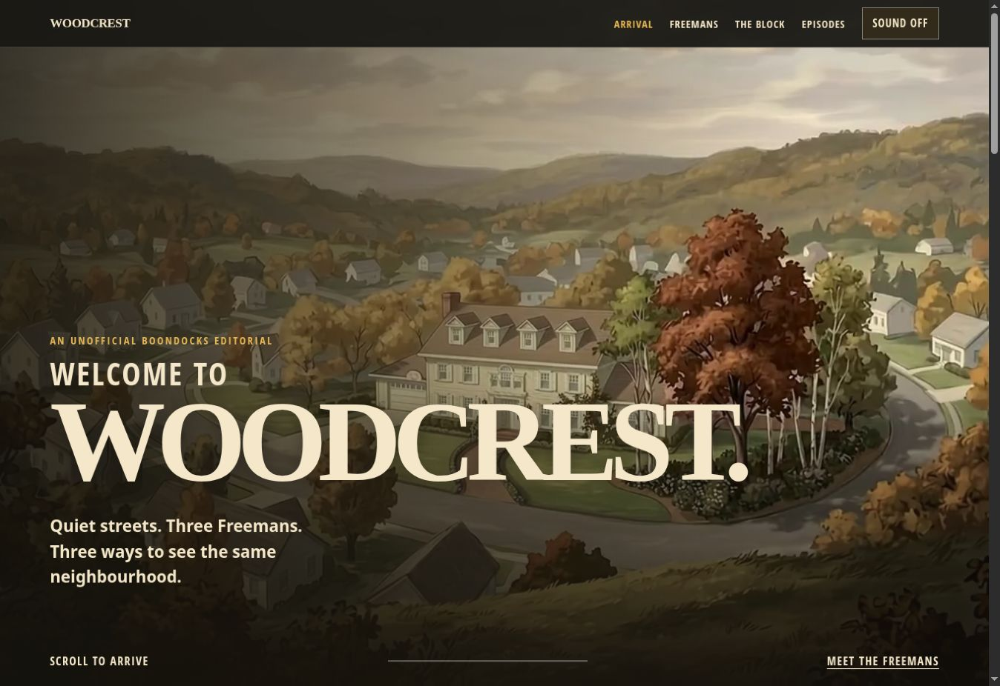

# Welcome to Woodcrest

An unofficial interactive editorial by Neo Leope at CyberByzance, based on Aaron McGruder’s *The Boondocks*. Scroll into Woodcrest, meet the Freemans, and explore how the series uses one suburb to stage very different perspectives.

[Explore the live site](https://trapsoulest1999.github.io/welcome-to-woodcrest/) · [Watch the walkthrough](media/Welcome_to_Woodcrest_Walkthrough.mp4)



## Creative direction

The arrival follows the road downhill until the Freeman house comes into view at street level. That last frame carries into the family gallery so the portraits feel rooted in the place the visitor just entered. A cream serif masthead, condensed navigation, autumn colour, and brick-red accents give the site an editorial rhythm inspired by the show. The neighbour chapter uses the supplied stills of Jazmine DuBois and Uncle Ruckus as visual references for the character commentary.

## Toolstack

| Area | Tools | Use |
| --- | --- | --- |
| Development workflow | ChatGPT/Codex | Art direction, technical implementation, iteration, and release verification |
| Motion and media | Google Flow, FFmpeg | Produce the arrival and Freeman portraits, prepare the video and stills, and encode portfolio media |
| Interface | React, TypeScript, CSS | Scroll-controlled arrival, draggable gallery, chapter navigation, and reduced-motion states |
| Build and hosting | Node.js, Vite, GitHub Actions, GitHub Pages | Build the static site and publish it after changes to main |

## What I built

- **Scroll-controlled arrival.** The viewer’s position maps to a time in the compressed arrival clip. A requestAnimationFrame callback updates the video and heading, and the street still holds at the end. Visitors can skip directly to the family.
- **A gallery that responds to drag, touch, and keyboard.** The portraits track horizontal drag, then settle on the next or previous character. A movement threshold distinguishes a drag from a click. On a touchscreen, vertical movement still scrolls the page.
- **Editorial chapters beyond the hero.** Character controls switch between Jazmine and Uncle Ruckus. The episode notes can be opened individually and link to episode details. An opt-in instrumental stays available throughout the site.
- **A static, accessible deployment.** The responsive layout keeps text in HTML, offers keyboard navigation, and uses a still frame and immediate character selection when reduced motion is preferred. Video, portraits, and fonts are served as separate files.

## How I would take it to production

| Area | Production design |
| --- | --- |
| Motion | Measure reverse scrubbing on mid-range phones and tune the seek cadence and keyframe interval against dropped frames. Put scroll thresholds and hold points into a typed manifest. |
| Media | Set transfer and decode budgets from measurements. Serve responsive image variants, consider a shorter mobile encode, and load the next chapter’s media just before it comes into view. |
| Accessibility | Test keyboard order, visible focus, screen-reader announcements, touch gestures, and reduced motion across representative devices. |
| Release | Add automated browser checks for the interactive chapters, asset availability, keyboard navigation, and deployment URLs. Keep fan editorial credits and media provenance close to the work. |

## Run locally

Requires Node.js 22 or later.

```sh
npm ci
npm run dev
npm run build
npm run preview
```

Vite builds the static site into `dist/`. The preview command serves that build locally.

## Publish with GitHub Pages

Choose GitHub Actions as the Pages publishing source. The workflow builds from `main`, uploads `dist/`, then deploys it in a separate job. Relative paths allow the project to run under the repository URL.

## Portfolio media

- [Walkthrough recording](media/Welcome_to_Woodcrest_Walkthrough.mp4)
- [Woodcrest arrival](media/01-woodcrest-arrival.jpg)
- [Meet the Freemans](media/02-meet-the-freemans.jpg)
- [Jazmine DuBois](media/03-jazmine-dubois.jpg)
- [Uncle Ruckus](media/04-uncle-ruckus.jpg)
- [Episode notes](media/05-episode-notes.jpg)

## Story and handoffs

| Chapter | Action on screen | Handoff | Media |
| --- | --- | --- | --- |
| Woodcrest | Scroll from a hillside overview to the Freeman house. | Land on the street still before entering the gallery. | Flow arrival clip and FFmpeg stills |
| The Freemans | Drag, swipe, or use the buttons to choose Huey, Riley, or Granddad. | Move from the household to its neighbours. | Three Flow portraits |
| Around the block | Switch between Jazmine and Uncle Ruckus. | Link their perspectives to the show’s satire. | Supplied series stills and HTML commentary |
| The show | Expand notes for *The Garden Party* and *The Block Is Hot*. | Follow the episode details or return to Woodcrest. | Original editorial copy and episode links |

## What the references contribute

PeachWeb’s BMW study informed the use of recognisable landmarks across camera angles and a distinct interaction for each chapter. The Metics Media design package informed planning the hero, a later section, and the phone layout together, then reviewing the result against the design checklist.

## References and credits

- [The Boondocks on Adult Swim](https://www.adultswim.com/videos/the-boondocks/)
- [Vince Toyama’s Woodcrest background studies](https://vtoyama.blogspot.com/2011/10/boondocks.html)
- [PeachWeb BMW E30 M3 study](https://bmw.peachworlds.com/)
- [Metics Media demo](https://www.youtube.com/watch?v=-7jk1Y7AU7w) and [design checklist](https://drive.google.com/file/d/15Ojdui_YbbDwgzotKxEktbQvuUVQh9K3/view)
- [Font notices](public/media/font-notices.txt)

The Boondocks characters and source stills are credited to the original series. This is an independent fan editorial. The site uses a separately synthesized instrumental.
